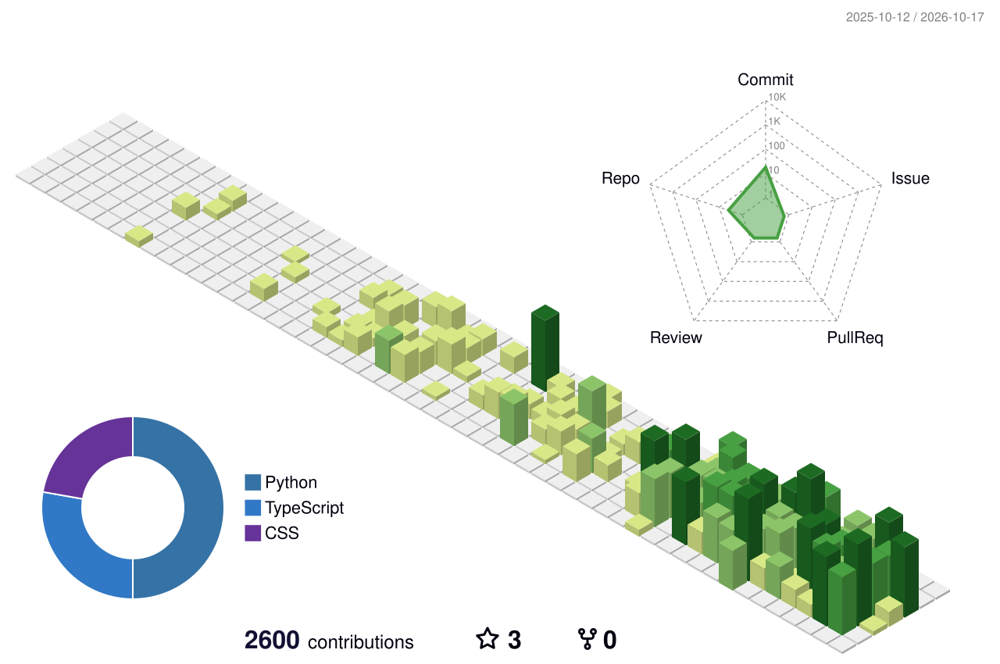

<!-- Header: animated wave -->

  

  

### `$ ls ~/stack`

  

### `$ git log --graph --3d`

<picture>
  <source media="(prefers-color-scheme: dark)" srcset="profile-3d-contrib/profile-night-rainbow.svg" />
  
</picture>

### `$ gh stats --user DonadoM`

  
  

### `$ ./snake --eat contributions`

<picture>
  <source media="(prefers-color-scheme: dark)" srcset="https://raw.githubusercontent.com/DonadoM/DonadoM/output/github-snake-dark.svg" />
  
</picture>

